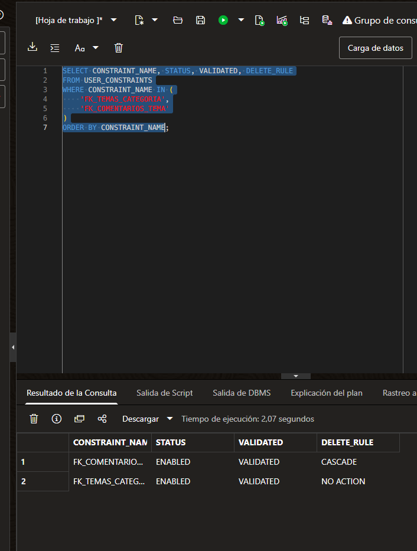

# Metadatos de claves foráneas en Oracle

31 de octubre de 2026. Captura SQL aportada por el usuario después de la consulta de ausencia de registros huérfanos.

| Constraint | Estado | Validación | Regla de borrado |
|---|---|---|---|
| FK_COMENTARIOS_TEMA | ENABLED | VALIDATED | CASCADE |
| FK_TEMAS_CATEGORIA | ENABLED | VALIDATED | NO ACTION |

Acredita configuración de las dos relaciones en Oracle. La captura previa de integridad acredita cero registros huérfanos; las pruebas Postman ya comprobaron borrado de tema/comentarios y rechazo de categoría en uso. Estos resultados no sustituyen las pruebas de carreras o bloqueo entre sesiones.

