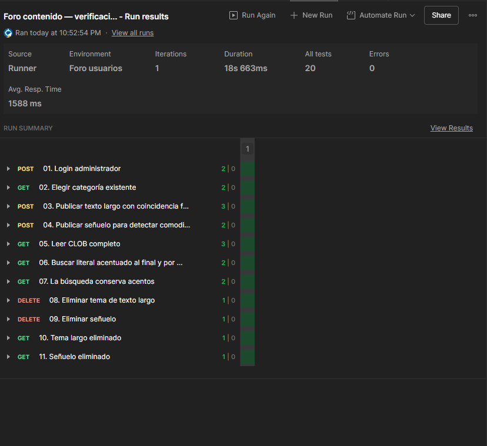

# Búsqueda y lectura CLOB en Oracle: Runner real

Fecha: 31 de octubre de 2026. Fuente: captura Postman aportada por el usuario con ambos servidores iniciados en perfil oracle.

- Colección adicional: Foro contenido — verificación CLOB Oracle.
- Una iteración, 11 solicitudes, 20 aserciones aprobadas, cero fallos/errores visibles.
- Duración: 18 s 663 ms.
- Se verificó lectura íntegra de contenido mayor de 9500 caracteres y coincidencia al final del CLOB, fuera del título.
- Búsqueda por texto y categoría: término en minúsculas frente al contenido acentuado en mayúsculas, caracteres %/_/! literales y exclusión de un señuelo que coincidiría con comodines.
- La búsqueda sin acento no devolvió coincidencias.
- Ambos temas temporales se eliminaron por sus IDs; las consultas finales devolvieron 404.
- La captura conserva únicamente resumen/estados de las pruebas, sin contraseñas o tokens. Es evidencia aportada por el usuario, no ejecución directa del agente.

Disponibilidad 503 sin escrituras y concurrencia/bloqueos Oracle siguen pendientes.
