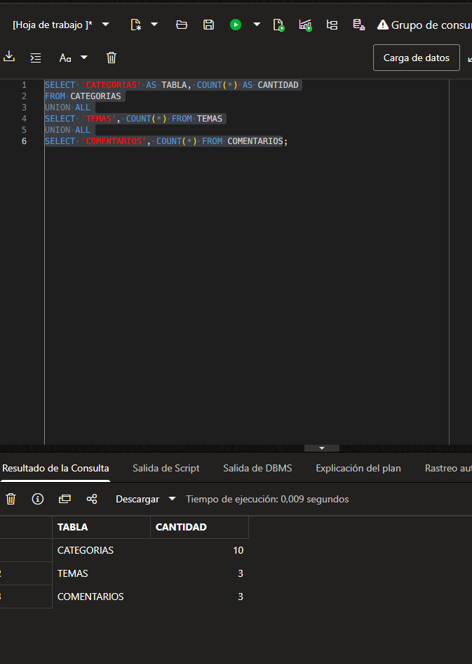

# Conteos Oracle de contenido, antes de reiniciar

Fecha: 31 de octubre de 2026. Fuente: consulta SQL y captura aportadas por el usuario, después de los recorridos Postman aprobados.

Resultado observado: CATEGORIAS: 10; TEMAS: 3; COMENTARIOS: 3. Se cumplen los mínimos de cinco categorías y tres registros por tabla.

Esta captura acredita registros consultados en Oracle antes de detener los servidores. Sirve como referencia para comparar después de reiniciar las mismas aplicaciones con perfil oracle; todavía no acredita la comprobación de reinicio ni la integridad completa de relaciones o los bloqueos concurrentes.

