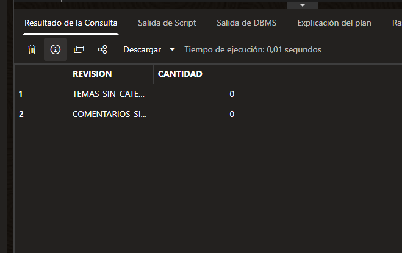

# Relaciones Oracle: ausencia de registros huérfanos

Fecha: 31 de octubre de 2026. Fuente: captura SQL aportada por el usuario después de confirmar los conteos tras reiniciar las aplicaciones.

- TEMAS_SIN_CATEGORIA: 0.
- COMENTARIOS_SIN_TEMA: 0.

La consulta LEFT JOIN verifica que los registros actuales tienen sus padres correspondientes. No demuestra por sí sola el estado de las constraints, su regla de borrado ni la corrección bajo concurrencia. La comprobación de metadatos de FK se realizará a continuación.

