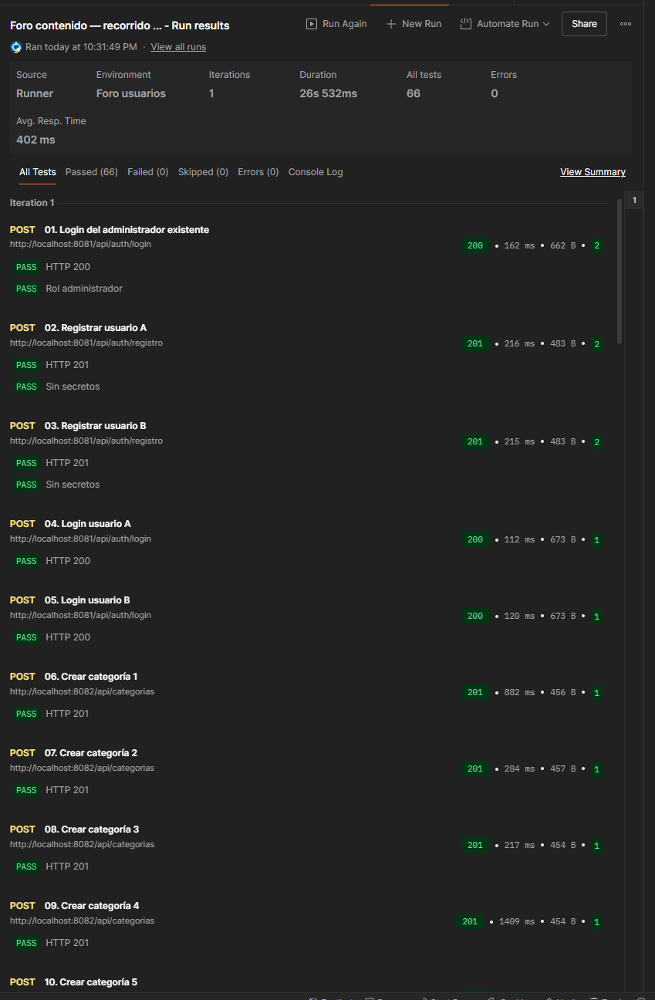

# Ejecución real de Postman: contenido

Fecha: 31 de octubre de 2026. Fuente: captura del Runner aportada por el usuario, tras iniciar los dos servicios con perfil oracle.

- Colección: Foro contenido — recorrido verificable, diseñada con 54 solicitudes.
- Entorno seleccionado: Foro usuarios, ampliado con contenidoBaseUrl. Una iteración.
- Resumen observado: 66 aserciones aprobadas, cero fallos, cero omitidas y cero errores.
- Duración: 26 s 532 ms.
- La captura muestra llamadas reales a usuarios en localhost:8081 y creación de categorías en contenido en localhost:8082.
- No contiene contraseñas ni tokens. Se conserva el resumen real aportado por el usuario; no se afirma ejecución del Runner por el agente.
- Continúan pendientes la consulta SQL final, persistencia después de reiniciar, búsqueda CLOB larga, caída de identidad sin escrituras, bloqueos/concurrencia Oracle y entrega.

